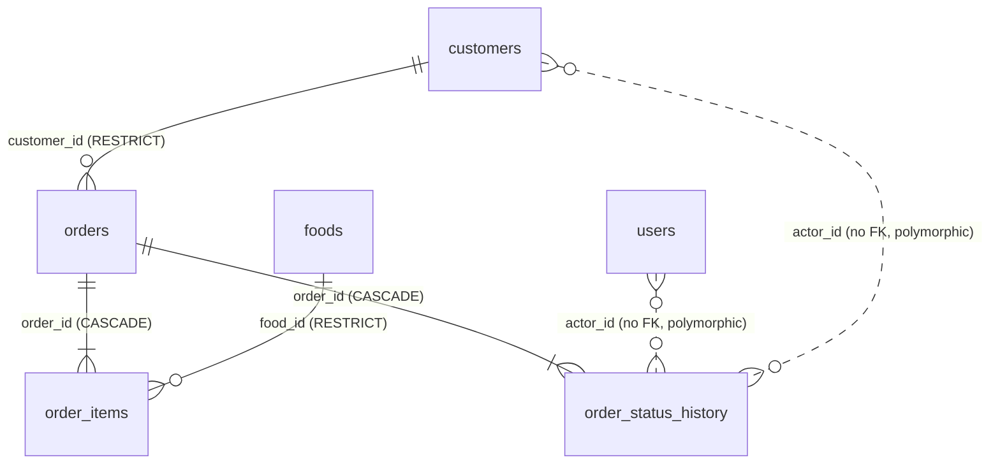

# Delivery notes

Status of the **Food Order Platform machine test**, written to be honest about what works and what does not. If something is not marked as done here, treat it as not done.

- **Repository:** TODO (add GitHub URL)
- **CI run:** TODO (link a successful run of `.github/workflows/ci.yml` after pushing)
- **Walkthrough recording:** TODO

## 1. Feature checklist

Legend: **Done**, **Partial**, **Not done**.

### Admin interface

| Requirement | Status | Notes |
| --- | --- | --- |
| Login with validation and unauthorized feedback | Done | Zod validation under the fields; server errors (wrong password, rate limit) shown above the form |
| Session expiry | Done | Any `401` signs the user out and returns to the login screen with a message; sign out also ends the session on the server |
| Dashboard with order counts by state | Done | Cards link to the orders list filtered by that state |
| Role-appropriate navigation | Done | Staff menu hidden for operators, the `/staff` route shows "Not allowed", and the server returns 403 |
| Users: list, create, edit, deactivate / reactivate, reset password | Done | Server-side search and role / status filters, pagination, confirmations, self-deactivation blocked |
| Foods: list, search, filter, create, edit, toggle availability, archive / restore | Done | Search, availability and category filters and pagination run on the server; category, price, image address, description |
| Foods: invalid price shows field errors | Done | Client validation plus server field errors mapped onto the form |
| Orders: filter, search, inspect, edit notes and fulfillment, status actions, timeline | Done | List with server-side search / status / fulfillment filters and pagination; separate order page `/orders/:id` |
| Cancellation requires a reason | Done | Dialog with validation; also enforced by the API |
| Loading, empty, error and success states | Done | Shared loading, error (with retry) and empty components on every list; success toasts |
| Responsive layout | Partial | Assuming the admin will open this application on desktop | Mobile menu, stacked grids, scrolling tables and bottom-sheet dialogs are implemented with Tailwind breakpoints. Done. Checked at 390px and desktop in Chrome", or list what's still off
| Accessibility | Partial | Labels on every field, errors linked with `aria-describedby`, `aria-label` on icon buttons, labelled landmarks, skip link, visible focus, dialog focus trap / Esc / focus return, `aria-live` for pagination text. **No automated (axe) or screen-reader audit was run** |

### Backend, data and security

| Requirement | Status | Notes |
| --- | --- | --- |
| Relational model, migrations, seed | Done | PostgreSQL via Sequelize. Seed: 1 administrator, 1 operator, 2 customers, 6 foods in 4 categories (1 unavailable), 6 orders covering every status with histories. The new migration back-fills existing rows (tested on an old-schema database with data) |
| Password hashing | Done | bcrypt, cost 10; the login path does the same work for unknown emails |
| Role enforcement | Done | Server-side middleware; the role is re-read from the database on every request |
| Token types separated | Done | `type` claim checked; tests send customer tokens to staff routes and the reverse (with colliding ids) |
| Immediate revocation | Done | Deactivation, password reset and logout bump `token_version` |
| Customer ownership | Done | `GET /mobile/orders/:id` and the list filter by the token's customer; another customer's order is a `404` (tested both ways) |
| Order state machine, cancellation reason, append-only history | Done | Enforced in the API; `from_status`, `to_status`, `actor_type`, `actor_id`, `reason`; a database trigger rejects `UPDATE` / `DELETE` (tested) |
| Server-calculated totals, unavailable foods rejected | Done | Integer-cent arithmetic; client prices ignored; all-or-nothing order creation (tested, including a 0.29 x 3 floating point case) |
| Duplicate / racing transitions | Done | Row lock (`FOR UPDATE`) in the transaction; optional `from` for stale clients (`STATE_CONFLICT`). **A test fires two simultaneous requests: exactly one succeeds and one history row is written** |
| Last active administrator protected | Done | Demotion and deactivation blocked; a test makes two administrators deactivate each other at once and exactly one succeeds |
| Operator may create foods | Done | Operators create and edit; only administrators archive / restore (tested) |
| Food category, currency, image URL; soft deletion | Done | Columns added; `archived_at` plus `RESTRICT` foreign key (a hard delete of an ordered food is refused by the database; tested) |
| Human-readable unique order reference | Done | `FO-000001` from a database sequence, unique constraint |
| Fulfillment type, subtotal, name / price snapshots | Done | `fulfillment_type`, `delivery_address`, `subtotal`, `total`, `food_name_snapshot`, `unit_price_snapshot`, `line_total` |
| Rate-limited login, no email disclosure | Done | Failed attempts only; one error for unknown email / wrong password / deactivated account |
| No secrets committed | Done | Environment-driven config; production refuses to start without `JWT_LOGIN_SECRET`. **The starting boilerplate contained real credentials; rotate them (see section 6)** |

### API

| Requirement | Status | Notes |
| --- | --- | --- |
| `/api/v1` prefix for everything | Done | Staff, mobile and auth routes all live under it |
| Pagination, search and filters | Done | `page` / `page_size` on every list; search and filters as query parameters; consistent envelope |
| Consistent error shape | Done | `{ error: { code, message, details } }` for validation, auth, conflicts, bad JSON, unknown routes and crashes |
| Validation | Done | zod schemas on body, query and path; field errors under `details.fields` |
| Staff: login, `GET /auth/me`, logout | Done | |
| Staff users: list, create, get, update, deactivate (+ activate), reset password | Done | |
| Foods: list, get, create, update, availability (+ archive, restore, categories) | Done | |
| Orders: list, get, `PATCH` notes / fulfillment, transitions, metrics | Done | |
| Mobile: login, published foods, create order, list own orders, get own order | Done | The old email one-time-code login was removed |
| OpenAPI file or Postman collection | Done | Both: `docs/openapi.yaml` (validated, 28 operations) and a Postman collection (21 requests, 23 assertions) run with newman |

### Testing and workflow

| Requirement | Status | Notes |
| --- | --- | --- |
| Backend tests | Done | 65 tests (13 unit, 52 API) against a real PostgreSQL test database: role denial, invalid / duplicate / terminal transitions, cancellation reason, concurrency, append-only history, customer A vs B, unavailable / archived foods, server totals and snapshots, token types, revocation, rate limit, validation |
| Frontend tests | Done | 26 tests (Vitest + Testing Library): login validation and errors, order page shows only allowed actions per status, cancel requires a reason and sends it, `from` is sent with transitions, operator denied on the staff route, food form validation |
| GitHub Actions on pull_request and push to main | Done (not yet run on GitHub) | Backend: lint, tests on PostgreSQL, build, `db:reset`, smoke script, newman. Frontend: lint, tests, build |
| Branches, focused commits, representative pull request | TODO | Depends on how the work is pushed; use the PR template |

### Documentation and evidence

| Item | Status |
| --- | --- |
| README with setup, env vars, accounts, commands | Done (phase time log and AI-assistance section need the author's input) |
| `docs/USER_MANUAL.md` | Done (no screenshots) |
| `docs/API.md`, `docs/openapi.yaml`, Postman collection | Done |
| `docs/DELIVERY.md` | This document |
| Screenshots | Done, see docs/screenshots/ |
| Walkthrough recording | **Not done** |
| Manual click-through of the admin interface against the live API | Done on 3 October 2026, admin and operator, desktop and mobile |

## 2. Stack and versions

| Area | Technology |
| --- | --- |
| Runtime | Node.js 20 in CI (verified locally on Node 22); npm 10 |
| Database | PostgreSQL 16 (verified locally on 16.15) |
| Backend | Node.js 20 with JavaScript (ES modules via Babel) | Express 5.1, Sequelize 6.37, pg 8.16, zod 4, jsonwebtoken 9, bcrypt 6, express-rate-limit 8, helmet 8, cors, convict; Babel for ES modules; Jest 30 + supertest; `standard` for lint | 
| Frontend | React 19, React Router 7, TypeScript 6, Vite 8, Tailwind CSS 3.4, react-hook-form 7, zod 4, axios 1.20; Vitest 5 + Testing Library; oxlint |

## 3. Data model

| Table | Columns | Keys, constraints, indexes |
| --- | --- | --- |
| `users` | `id` bigint, `name`, `email`, `password_hash`, `role` enum(`admin`,`operator`), `is_active` boolean default true, `token_version` integer default 0, `created_at`, `updated_at` | PK; unique `email` |
| `customers` | `id`, `name`, `email`, `password_hash`, `phone` (nullable), timestamps | PK; unique `email` |
| `foods` | `id`, `name`, `description` (nullable), `category` varchar(100) default `Uncategorized`, `price` numeric(10,2), `currency` varchar(3), `image_url` (nullable), `is_available` boolean, `archived_at` (nullable), timestamps | PK; CHECK `price > 0`; indexes `lower(name)` and `category` |
| `orders` | `id`, `reference` varchar(20), `customer_id`, `status` enum(`Placed`..`Cancelled`), `fulfillment_type` enum(`pickup`,`delivery`), `delivery_address` (nullable), `notes` (nullable), `subtotal` numeric(10,2), `total` numeric(10,2), timestamps | PK; unique `reference` (from sequence `order_reference_seq`); FK `customer_id` -> `customers` RESTRICT; CHECK amounts >= 0; CHECK delivery needs an address; indexes on `customer_id`, (`status`, `created_at`), (`created_at` desc, `id` desc) |
| `order_items` | `id`, `order_id`, `food_id`, `food_name_snapshot`, `unit_price_snapshot` numeric(10,2), `quantity` integer, `line_total` numeric(10,2), timestamps | PK; FK `order_id` -> `orders` CASCADE; FK `food_id` -> `foods` RESTRICT; CHECK `quantity > 0`; indexes on `order_id` and `food_id` |
| `order_status_history` | `id`, `order_id`, `from_status` (nullable enum), `to_status` enum, `actor_type` enum(`staff`,`customer`,`system`), `actor_id` bigint (nullable), `reason` (nullable), `created_at` | PK; FK `order_id` -> `orders` CASCADE; index (`order_id`, `created_at`); trigger rejects `UPDATE` and `DELETE` |

Decisions and trade-offs:

- **Money precision:** prices and totals are `numeric(10,2)`, computed in integer cents, and returned as strings; there is no floating point anywhere in the path.
- **Transactional order creation:** the order, its lines, the reference and the first history row are created in one transaction; foods are read with a shared row lock so staff cannot archive or reprice a food mid-order. A failure leaves nothing behind.
- **Snapshots:** `food_name_snapshot` and `unit_price_snapshot` keep what the customer saw even after the food is renamed, repriced or archived.
- **RESTRICT instead of CASCADE:** foods and customers with orders cannot be hard-deleted, which protects order history. Foods are archived instead.
- **Append-only history:** enforced by a trigger, so even a buggy query or a manual `UPDATE` cannot rewrite it. `TRUNCATE` bypasses row triggers; the seed's `down` and `db:reset` rely on that.
- **`actor_id` has no foreign key** because it points at `users` or `customers` depending on `actor_type`. Names are resolved when an order is read.
- **Indexes:** `orders (status, created_at)` and `created_at desc` serve the admin lists; `customer_id` serves the mobile list; `order_items (order_id)` serves order detail. Search uses `ILIKE '%...%'`, which no btree index can serve (see limitations).
- **Roles:** one enum on `users` is enough for two fixed staff roles; customers are a separate table and a separate token type.
- **Migrations:** the schema change from the original boilerplate is one migration that back-fills data. It is **not reversible**; use `npm run db:reset` to rebuild.

## 4. Environment and deployment notes

- Configuration is entirely by environment variables (README lists them). `.env` files are ignored by git.
- `NODE_ENV=production` requires `JWT_LOGIN_SECRET`; hosted databases usually need `DB_SSL=true`.
- Run `npm run build` then `npm start` in `backend`; serve `frontend/dist` from any static host and set `VITE_API_URL` at build time. Set `CORS_ORIGIN` to the admin UI origin.
- Production deployment is out of scope and has not been tested. Rate limits are in memory per process and would need a shared store behind several instances.

## 5. Test results

Run locally on 2 October 2026 (Node 22, PostgreSQL 16.15). Replace or supplement with the CI link once the workflow has run on GitHub.

| Check | Result |
| --- | --- |
| Backend lint (`npm run lint`) | Passed, 0 problems |
| Backend tests (`npm test`) | 65 of 65 passed; run repeatedly with no flaky failures after the fixes below |
| Backend build (`npm run build`) | Passed |
| Migration back-fill on an old-schema database containing data | Passed (references, snapshots, `is_active`, history actor ids verified) |
| Fresh `db:reset` (migrate + seed) | Passed |
| API smoke test against the built server (`scripts/smoke-test.sh`) | 37 of 37 checks passed |
| Postman collection with newman | 19 requests, 35 assertions, 0 failures (run repeatedly) |
| OpenAPI file | Validates as OpenAPI 3.0.3 (22 paths, 28 operations, matches the router) |
| CORS preflight for `PATCH` from the UI origin; a foreign origin | Allowed; rejected with 403 |
| Frontend lint (`npm run lint`) | 0 errors, 6 warnings (React "setState in effect" advisories on data-loading effects) |
| Frontend tests (`npm test`) | 26 of 26 passed |
| Frontend typecheck and build (`npm run build`) | Passed (one chunk-size advisory; the bundle is not code-split) |

- **Duplicate id:** the category filter and the food form's Category field both used `id="food-category"`, so the label focused the wrong control. The filter is now `food-category-filter`.
- **Stale data:** data-loading effects set state synchronously, and late responses could overwrite newer ones. They now ignore outdated responses (4 lint warnings cleared).
- **Fast refresh:** `Foods.tsx` exported its form schema, which disabled fast refresh. The schema moved to `foodSchema.ts`.
- **Form watcher:** the fulfillment form used `watch()`, which is incompatible with React's memoization. Replaced with `useWatch()`.
- **Bundle size:** the bundle was 501 kB, over Vite's 500 kB limit. Pages are now lazy-loaded; the main chunk is 392 kB.
- **Currency:** changed from USD to AED for the Dubai client. Prices converted at 3.6725 and rounded; all tests updated and passing.

Defects found and fixed while preparing this delivery:

- A customer token was accepted on staff routes because the two token types shared a secret and the staff check only looked at the user id. Tokens now carry a verified `type` claim, with tests that fail without the fix.
- The one-time-code login exposed an inbox link containing the code and stored codes in plain text. The whole flow was removed.
- Deleting a food that had been ordered silently removed those lines from order history. Foods are now archived and the foreign key is `RESTRICT`.
- The login limiter counted successful logins; it now counts failed attempts only.
- **Deadlock:** two administrators deactivating each other at the same moment deadlocked in PostgreSQL and returned a 500. Found by the new concurrency test; fixed by always locking the administrator rows in id order before the target row.
- **Response before commit:** staff update and deactivate answered the client from inside the transaction, so a fast follow-up request could still see the old state. Found by an intermittent test failure; fixed by responding only after the commit.
- Database credentials and other secrets that were present in configuration files from the starting boilerplate were removed and configuration is environment-driven.

## 6. Limitations and known issues

- **Rotate leaked secrets.** The boilerplate contained a hosted database connection string and a third-party refresh token. They were removed from this code base, but anything that was ever committed or shared should be treated as compromised: change the database password and revoke / regenerate the token. Do not push the original repository's history; start a new repository from this code.
- The browser keeps the access token in `localStorage`, which script injection (XSS) could read. A production design would use httpOnly cookies and refresh tokens. There are no refresh tokens; a token lasts 2 days by default.
- Logout, password reset and deactivation end **all** sessions of that staff user (not just the current device). A staff user who resets their own password is signed out. Customer tokens cannot be revoked before they expire (no customer logout endpoint, no customer registration endpoint).
- Rate limiting is in memory, per process and per IP. Behind a proxy set `TRUST_PROXY` correctly or every user shares one counter.
- One configured currency. It is stored on each food, but orders take the currency label from configuration at read time; changing `CURRENCY` later would relabel old orders without converting amounts. A real multi-currency design needs a currency on the order.
- Search uses `ILIKE '%term%'`, which scans the table. This is fine for a restaurant-sized catalogue; for large data add a `pg_trgm` GIN index (skipped here because it needs the extension and privileges to create it).
- Pagination is offset based; very deep pages are slow and rows can shift between requests while new orders arrive. Keyset pagination would fix that.
- Foods have an image **address** only; there is no upload or image hosting.
- Orders cannot be created by staff, items cannot be edited after placement, and there are no payments, taxes, delivery fees or discounts; the total equals the sum of the lines.
- The order list refreshes by polling every 30 seconds; there are no push notifications.
- `db:reset` and the test setup are destructive by design (local databases only). The new migration cannot be rolled back.
- Seed credentials are for local development only.
- Accessibility and responsiveness were implemented carefully but not audited with tools or real devices (section 1).

## 7. Handover steps

1. Clone the repository and follow the README to create the database, then run `npm run db:migrate` and `npm run db:seed` in `backend` (or `npm run db:reset` for a clean local rebuild).
2. Start the backend (`npm run start:dev`) and frontend (`npm run dev`) and sign in with the seeded accounts.
3. Run `npm test` and `npm run lint` in `backend`, and `npm test`, `npm run lint` and `npm run build` in `frontend`.
4. With the backend running, run `./scripts/smoke-test.sh` and the Postman collection to exercise authorization, the mobile order flow and the status workflow.
5. Push to a new repository using feature branches and pull requests, let CI run once, and link the run above.
6. Read section 1 and section 6 before extending the project. Suggested next work: refresh tokens and httpOnly cookies, currency on orders, trigram search, keyset pagination, customer registration and logout, image upload, an accessibility audit.